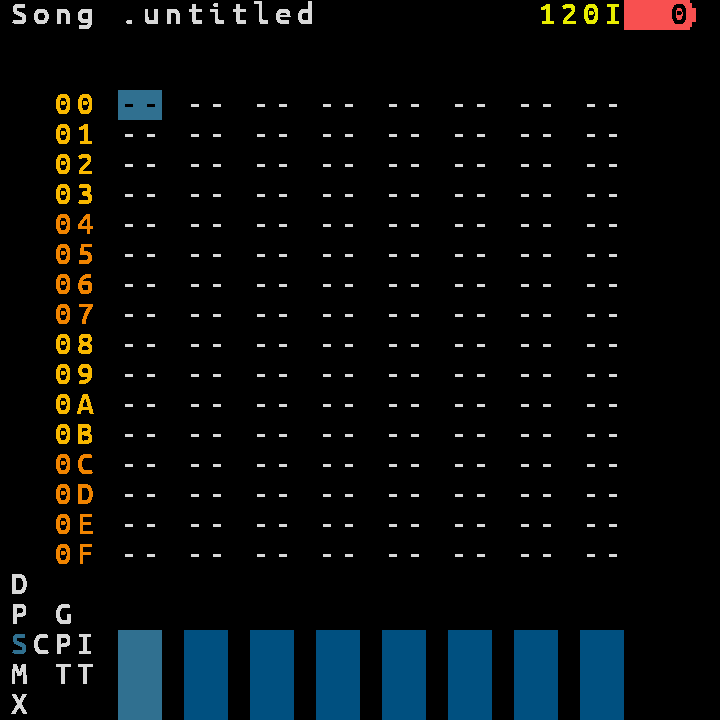

# picoTracker Advance on desktop and Trimui



This repository runs the [picoTracker Advance](https://github.com/xiphonics/advance-firmware) tracker on the **Trimui Smart Pro** (NextUI, tg5040) and on **macOS**. It is a thin wrapper: Xiphonics' firmware is pulled in unmodified as a pinned git submodule (`upstream/advance-firmware`, tag `v3.2.1`), and the wrapper under `platform/` supplies what the firmware expects from hardware (display, buttons, audio out and in, filesystem, sample memory, MIDI on macOS) using SDL2.

Nothing here is an official Xiphonics release. Please do not report problems with this port to them.

## Status

| Area | macOS | Trimui Smart Pro |
| --- | --- | --- |
| Builds | yes (CMake, SDL2) | yes (Docker cross build, CI zip) |
| Firmware boots, Song view draws | yes, checked by `scripts/check-macos.sh` | boots in an emulated container; **not yet seen on the real panel** |
| Audio out | yes (CoreAudio) | measured on the device: playback runs without underruns during play (one at start-up per run) |
| Recording | yes | **mono** from the built-in mic, measured on the device |
| Sample memory | 128 MiB default (`--sample-memory-mib`) | 384 MiB, measured with no OOM and about 400 MB still available |
| Input | keyboard | virtual gamepad checks only; the **real buttons are untested** |
| MIDI | CoreMIDI | out of scope |

Known gaps, honestly:

- **The Trimui display is unproven.** The device's `/dev/fb0` hung in the kernel after earlier probes, so the picture could not be captured and the on-device acceptance run (long-run, exit chord, relaunch) is blocked until the board is power-cycled. See [display findings](planning/findings/trimui-display.md) and [acceptance status](planning/findings/trimui-acceptance.md).
- Recording on Trimui: a headset on the jack, Line In after the mono fix, and changing the source in the UI (Edit+Right did not change it in one try) are not verified. See [recording findings](planning/findings/trimui-recording.md).
- Linux and Windows desktop builds are not supported targets yet (CI builds Linux as a check only). See [portability](planning/findings/sprint-3-portability.md).
- NextUI is the only supported Trimui firmware. The macOS bundle is arm64-only and ad-hoc signed.

## Build

Clone with the submodule:

```sh
git clone --recurse-submodules <this repository>
# or, in an existing clone:
git submodule update --init --recursive
```

### macOS

Needs CMake, a C++ toolchain and SDL2 (`brew install cmake sdl2`).

```sh
cmake -S . -B build/app -DCMAKE_BUILD_TYPE=Release
cmake --build build/app --target picotracker_macos_app
```

This produces `build/app/bundle/picoTracker Advance Desktop.app`; copy it to `/Applications` or anywhere else (see [ADR 0015, macOS bundle](docs/adr/0015-macos-bundle.md)). For a plain binary, `cmake -S . -B build/advance-v3 && cmake --build build/advance-v3` builds `build/advance-v3/picotracker_desktop`.

Checks: `bash scripts/check-macos.sh` runs the whole acceptance (build, host checks, firmware boot, project and WAV compatibility, audio, CoreMIDI, bundle launch, screenshot in `build/macos-check/`; `PICOTRACKER_AUDIO_SECONDS=60` for the long audio run). A headless smoke test: `SDL_VIDEODRIVER=dummy build/advance-v3/picotracker_desktop --smoke --data-dir build/smoke-data`.

### Trimui Smart Pro (Docker cross build)

Needs Docker. The toolchain image is built from `docker/trimui/`.

```sh
scripts/build-trimui.sh      # writes build/trimui/picotracker_desktop (aarch64)
scripts/package-trimui.sh    # writes build/trimui/PicoTracker-trimui-tg5040-<version>.zip
```

The binary links the device's own vendor SDL2 dynamically (see [ADR 0015, toolchain](docs/adr/0015-trimui-cross-toolchain.md) and [ADR 0016](docs/adr/0016-trimui-input-display.md)).

## Install on the Trimui Smart Pro

1. Get `PicoTracker-trimui-tg5040-<tag>.zip` from the GitHub release page. For an untagged commit, download the `PicoTracker-trimui-tg5040-<commit>` artifact of the `trimui-cross` job in the `linux-arm64` workflow run (GitHub wraps it in another zip; unpack that first). Or build it as above.
2. Put the SD card in your computer and extract the zip at the **SD card root**, so `Tools/tg5040/PicoTracker.pak/` exists.
3. Put the card back, start **PicoTracker** from NextUI's Tools list.
4. Update: delete `Tools/tg5040/PicoTracker.pak` and extract the new zip. Projects and samples are kept. Uninstall: delete the pak; also delete `.userdata/tg5040/PicoTracker/` to remove your data.

Installing over ssh and the first-run checklist are in [docs/trimui-first-run.md](docs/trimui-first-run.md). The deploy and test scripts read the device address and credentials from the environment (`TRIMUI_SSH_USER`, `TRIMUI_SSH_HOST`, `TRIMUI_SSH_PORT`, `TRIMUI_SSH_PASSWORD`, `TRIMUI_SD_ROOT`) or use an ssh key.

## Controls

On the Trimui: D-pad moves, east face button is A, south is B, L1 and R1 are L and R, Start and Select as labelled. **Exit by holding Select + Start + L1 + R1 together.** Menu belongs to NextUI. Remap with `.userdata/tg5040/PicoTracker/input.ini` (format in [the first-run guide](docs/trimui-first-run.md#controls-and-inputini)).

On macOS: arrow keys navigate and Escape quits; the 720x720 window is the default.

For how to use the tracker itself, see the [picoTracker Advance documentation](https://github.com/xiphonics/advance-firmware).

## Recording

Use source **Mic** on the Record screen. The Smart Pro has one built-in microphone, so the file is mono, 16-bit, 44.1 kHz. The firmware's default source, Line In, is stereo with noise on the right channel; the launcher sets `PICOTRACKER_LINEIN_MONO=1` to copy the left channel to the right. Recordings are saved as `REC01.wav`, `REC02.wav` and so on and loaded from the sampler's file browser. The launcher saves and restores the ALSA mixer around the run. Samples share a memory budget: 384 MiB on Trimui (`--sample-memory-mib` in the pak's `launch.sh`), 128 MiB on macOS; a sample that no longer fits fails to load. Details: [docs/trimui-first-run.md](docs/trimui-first-run.md#recording-on-the-device).

## Where data lives

| Platform | Location |
| --- | --- |
| Trimui | `.userdata/tg5040/PicoTracker/` on the SD card: `projects/`, `samples/`, `recordings/`, `logs/picotracker.log`, optional `input.ini` |
| macOS | `~/Library/Application Support/picoTracker/Advance Desktop/` |
| Any | `--data-dir PATH` selects another folder |

## Project layout

- `upstream/advance-firmware`: the unmodified Xiphonics firmware (submodule).
- `platform/`: the wrapper (SDL window, input, audio, filesystem, sample memory, CoreMIDI).
- `packaging/`: macOS bundle and Trimui pak files; `scripts/`: build, package, deploy and check scripts; `docker/`: the cross toolchain image; `tests/`: host and device checks.
- `patches/`: a proposed upstream fix (not applied; see [patches](patches/)). Pass `-DPICOTRACKER_UPSTREAM_ROOT=/path/to/copy` to CMake to build against a disposable upstream copy.
- `docs/adr/`: architecture decisions; `planning/findings/`: measurements and evidence behind the status above.
- `planning/`, `work/`, `runs/`, `orchestrator.py`, `ORCHESTRATOR.md`: the Kanban boards, job records and small scheduler used to run the early project. They are history, not needed to build or use the port; see [docs/project-history.md](docs/project-history.md).

### Architecture decisions

ADRs are in [docs/adr/](docs/adr/), numbered 0001 to 0018. **Two ADRs share the number 0015**: [0015-macos-bundle.md](docs/adr/0015-macos-bundle.md) and [0015-trimui-cross-toolchain.md](docs/adr/0015-trimui-cross-toolchain.md). Both are cited by number across the repository, so neither was renamed; read "ADR 0015" in Trimui text as the toolchain ADR and in macOS text as the bundle. The Trimui ADRs are [0014](docs/adr/0014-trimui-linaro-gcc7-toolchain.md), [0015](docs/adr/0015-trimui-cross-toolchain.md), [0016](docs/adr/0016-trimui-input-display.md), [0017](docs/adr/0017-trimui-package-layout.md) and [0018](docs/adr/0018-trimui-audio-capture.md).

## Contributing

See [CONTRIBUTING.md](CONTRIBUTING.md).

## Licensing

The wrapper is licensed **GPL-3.0-only**: see [LICENSE](LICENSE). [NOTICE.md](NOTICE.md) lists the file-level licences and every third-party component, and the Trimui pak ships the licence texts and a source offer.

This project builds on the work of [Xiphonics](https://github.com/xiphonics): the [picoTracker](https://github.com/xiphonics/picoTracker) and the [Advance firmware](https://github.com/xiphonics/advance-firmware), which is compiled in unmodified and keeps its own licences. Thanks to them, and to the authors of the libraries credited in NOTICE.md.
