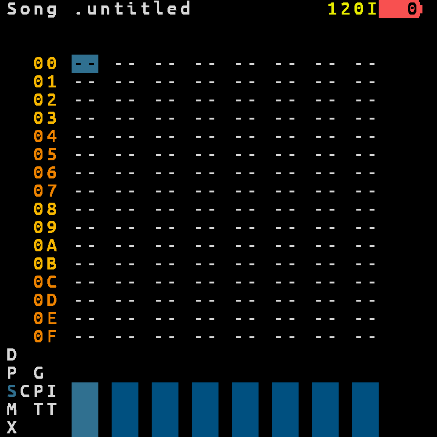

# Sprint 4 macOS release acceptance

Card C-7. Run: `PICOTRACKER_AUDIO_SECONDS=8 bash scripts/check-macos.sh`, exit
status 0, on macOS (Darwin 25.5.0, arm64), Homebrew SDL2 (sdl2-compat over
SDL3), submodule `upstream/advance-firmware` at `v3.2.1` (`0282da7`).

## Results

| Criterion | Result |
| --- | --- |
| Local build (Debug, CMake) | passes |
| Host adapter checks (`host_filesystem_check`, `host_event_check`) | pass |
| Firmware boot (`--smoke`, dummy video) | boots the Song view; Down key changes the frame (hash `3f508aa5…` → `dad09b6b…`) |
| Project and WAV compatibility (`tests/compatibility_check.py`) | project create/reload and WAV capacity checks passed |
| Audio (`tests/macos_audio_check.cpp`, 8 s run) | 0 failures: real CoreAudio device, non-zero signal, 5 start/stop cycles, stream clock within 250 ms of wall time, device-loss fallback and recovery |
| MIDI (`tests/macos_midi_check.cpp`, virtual CoreMIDI ports) | passes |
| Copied-bundle launch (ADR 0015) | `picoTracker Advance Desktop.app` copied to a fresh temp directory; two consecutive `--smoke` runs succeed and the second reads the first's `.config.xml`; `DYLD_PRINT_LIBRARIES` shows `libSDL2` and `libSDL3` loaded from the copy and none from `/opt/homebrew`; `codesign --verify --deep --strict` passes |
| Upstream submodule | clean (`git status --porcelain` empty inside it, pinned commit checked out) |

The 60 s audio run recorded in `sprint-4-audio-validation.md` was not repeated;
the script defaults to 8 s through `PICOTRACKER_AUDIO_SECONDS` (set it to 60 for
the long run).

## First view

Song view of the untitled project, 720×720, captured by `--screenshot` from the
CMake build (the bundled executable is the same binary).

## Remaining limitations

- **Audibility is not verified by the scripts.** The audio check proves a
  non-zero signal reaches an open CoreAudio device at real time, not that the
  speaker produces sound. The firmware's own mixer output was not part of the
  check (`--smoke` runs with the dummy video driver and no sound assertion).
- **MIDI uses virtual ports only.** No USB/TRS hardware, no physical unplug.
  The `MacBackend`/`HostMidiService` composition and the settings device list
  are exercised through the app's startup log (`midi in: picoTracker In
  (virtual)`) but not by a routing test. Open defects D-1 and D-2 in
  `sprint-4-midi-validation.md` still apply.
- **Bundle is local only**: ad-hoc signed, not notarized, arm64 only, depends
  on the Homebrew SDL build used at bundle time (ADR 0015). A bundle moved to
  another Mac may need the quarantine attribute cleared.
- **Smoke screenshot logs** `SampleEditorView: Failed creating temp filename`
  and, on the first run of a fresh data directory, `Failed to open file:
  /.config.xml`; both are upstream/first-run noise and do not affect the boot
  result.
- Linux and Windows verification remain open (`sprint-3-portability.md`).
